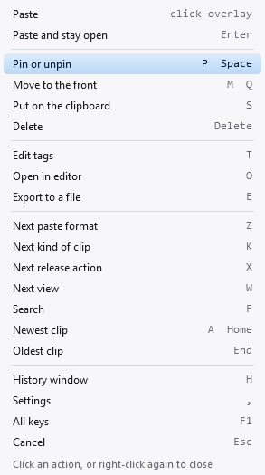

<!-- Generated from docs/help/mouse.html by tools/generate-markdown-help.py. Do not edit. -->

[Manual index](README.md)

# Using the mouse

**PasteJump is built for the keyboard, and needs nothing else — but while the overlay is open, the hand already on the mouse can scroll through clips, click the one it wants, and ask any part of the overlay what it means.**

The mouse is only listened to while the overlay is open. At every other moment the wheel, right-clicks and left-clicks go to your programs exactly as they always do — `Ctrl`+wheel still zooms your browser. Nothing the mouse does moves the keyboard away from the program you are pasting into, so the paste still lands where your cursor was.

## The wheel

Turn the wheel towards you for older clips and away from you for newer ones, then release `Ctrl` to paste. It steps exactly as `↓` and `↑` do, through search results too. Hold `Ctrl` with one hand and keep the other on the mouse. Inside the gesture `Ctrl`+wheel never reaches the program underneath, so it cannot zoom it while you are choosing a clip.

## Clicking a clip

**Click the overlay to paste the clip it shows.** In the [list](views.html#list-view) and [thumbnails](views.html#thumbnails-view) views you can click any of the other clips as well: the row or tile under the pointer is tinted as you move over it, and clicking it pastes that clip at once.

Pointing on its own changes nothing. The current clip — the one with the accent outline — stays where it is until you click, so a pointer that happens to rest on the overlay can never change what releasing `Ctrl` pastes. A click counts only if you let go of the button on the same row or tile you pressed it on, so sliding off before letting go is the way to change your mind.

## Tooltips

**Everything on the overlay explains itself.** Rest the pointer on anything that carries meaning and, after the same short pause a Windows tooltip takes, a tip says what it is and which key changes it:

- **A tile or a list row** describes its clip — its kind and size, when it was copied and from which program, its tags — and how to reach it: the digit that jumps there, or a click.
- **The top line** — the position, PINNED, the tags, where the clip came from, the paste format, POP, LOCKED, the kind filter, JOIN — says what each means and names the key that changes it, using your own letters.
- **Each key in the hint along the bottom** gets a sentence: pointing at *L: lock open* explains locking.

Moving across the overlay does not flash a tip for everything it crosses; a tip appears only where the pointer settles. Any click, or closing the overlay, puts it away.

## The buttons on the top line

The overlay's top line ends with two buttons. **The view** — its icon, name and key, such as *Thumbnails (W)* — switches to the next view for this paste; see [the views](views.html#switch-view). **The gear** closes the overlay, pasting nothing, and opens Settings; `Ctrl+,` does the same from the keyboard.

## The right-click menu

**Right-click anywhere while the overlay is open** for a menu of everything you can do to the clip, each action with its key beside it. Click one to do it. It is the quickest way to find an action you have not learnt the letter for yet — and the letters are right there for next time.

*Every row names the key that does the same thing — your own letters, if you have changed them in Settings, Keys. Actions you have switched off are left out.*

- **Opening the menu locks the overlay**, exactly as `L` does, so you can let go of `Ctrl` to use the mouse without pasting anything.
- **Paste** pastes the clip and closes everything; **Cancel** puts the previous clipboard back.
- Rows whose effect you read off the overlay — pinning, the paste format, the kind of clip, the view, jumping to the newest or oldest — leave the menu open for the next one. The rest close it.
- **Settings** closes the overlay, puts the previous clipboard back and opens Settings, as the gear does.
- Right-click again, or click anywhere off the menu, to close it. The keys and the wheel go on working while it is open.

## Turning it off

The wheel and the clicks can be turned off separately, on the Paste Mode tab of Settings: *Step Through Clips with the Mouse Wheel*, and *Right-Click for a Menu of Actions* — which covers every click on the overlay, the menu, the tiles and rows, and the two buttons.
