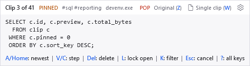
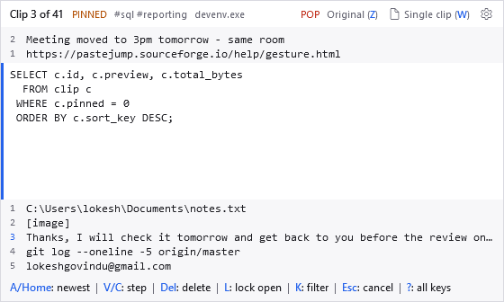
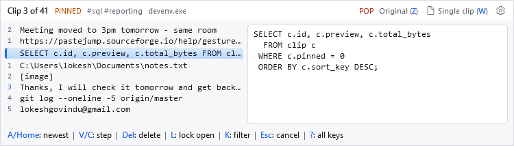
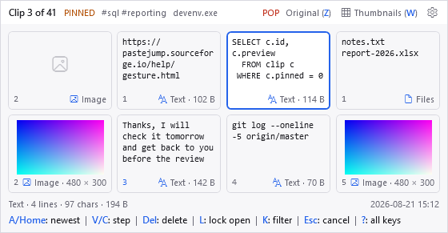

<!-- Generated from docs/help/views.html by tools/generate-markdown-help.py. Do not edit. -->

[Manual index](README.md)

# The overlay's views

**The overlay can show the stack three ways: one clip at a time, as a list, or as thumbnails. Choose one on the [Style tab of Settings](settings.md); press `W` during a paste to try another for that paste only.**

## One clip at a time

The default, and the overlay as it has always been: the current clip, with as much of its text or picture as fits, its facts underneath, and its place in the stack along the top. `V` steps to the next clip and the overlay redraws around it.

*One clip, its place in the stack, and along the top line the view button and the gear.*

**It keeps still while you step.** The list and thumbnails views are one size throughout. The single-clip view fits each clip, but where it is centred on the screen — in programs with no text cursor for it to sit beside — its top-left corner stays put, so it grows and shrinks from the bottom and right instead of jumping. Tick *Keep the Overlay One Size* (the gear on the Single Clip card) to hold it at one size.

## The list view

Choose **List** on the [Style tab of Settings](settings.md) and the overlay shows the clips either side of the current one as well — newer above, older below, one line each — so you can see the clip you want before you get to it.

*The current clip is the one with the bar down its left edge. The numbers are how many steps away each row is.*

*With *Show the Preview Beside the List* on (the gear on the List card): every clip is a row, and the current one's preview has a pane of its own to the right.*

**The number beside a row is the key that jumps there.** Press `3` and you land on the row numbered 3 below. For the rows above, press `−` first to turn the digits round, as always. A pinned clip's number is drawn in the accent colour.

Everything else works exactly as before — `V`, the arrows, the wheel, search and the right-click menu all move the same current clip, and the rows follow it. A search or a kind filter narrows the list too, so every row is one you can reach. The list **goes round the ends**, as stepping does: on the newest clip the rows above it are the oldest ones, because that is where `Up` takes you, and a thin line marks where it wraps. How many rows appear above and below is set behind the gear on the List card, from none to nine each; every row is a line of height beside your cursor, so the defaults are two and five.

## The thumbnails view

Choose **Thumbnails** on the Style tab and the same clips are drawn as tiles instead of rows: a picture for an image, the first few lines of a text clip, the names of copied files. If you copy a lot of screenshots, this is the view where you can tell them apart at a glance.

*Newer clips, the current one outlined, then older ones — in the order of the stack, left to right and down. Each tile's number is the digit that jumps to it.*

- The tiles follow the stack in reading order. **The arrows move as they look:** `→` and `←` go to the next or previous tile, `↓` and `↑` to the tile directly below or above — a whole row at a time. `V` and the wheel step one tile, as everywhere else.
- **Every tile says what it is.** Along its bottom are its number and, on the right, an icon and its kind and size — *Text · 404 B*, *Image · 1198 × 674*, *Files* — so a path, a copied file and a picture can be told apart at a glance. A picture's dimensions appear once its thumbnail has loaded.
- Numbers work exactly as in the list view — press the digit on a tile to jump to it.
- Under the tiles is the current clip's information line, the same one the single-clip view shows: what kind of clip it is, its lines and characters or its picture's size, how large it is, and when it was copied.
- Pointing at a tile tints it and shows a tooltip describing the clip; clicking it pastes it — see [Using the mouse](mouse.md).
- A picture appears a moment after its tile, the first time that clip is shown: it is read and shrunk in the background, so stepping is never held up by a large screenshot. After that it is remembered.
- The tile size, how many tiles make a row and how many clips appear before and after the current one are the view's own options — click the gear on the Thumbnails card in Settings, Style. Four sizes, from Small to Extra large; a larger tile gets a sharper picture and more lines of text.

## Switching the view for one paste

The overlay's top line ends with the view you are in — its icon, its name and its key, such as *Thumbnails (W)* — and the gear. **Clicking the view switches to the next one**; `W` does the same from the keyboard. The switch lasts for this gesture only: the next time you press `Ctrl+V` the overlay opens in the view chosen in Settings, Style, which the switch never changes. The second button, the gear, opens Settings.

The views' own options — the image preview size for a single clip, the rows for the list, the tile size for the thumbnails — are behind the gear on each card in [Settings, Style](settings.md).
